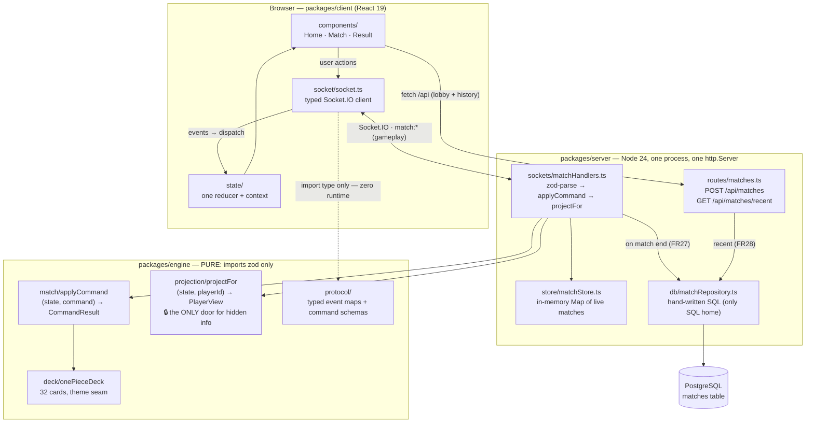
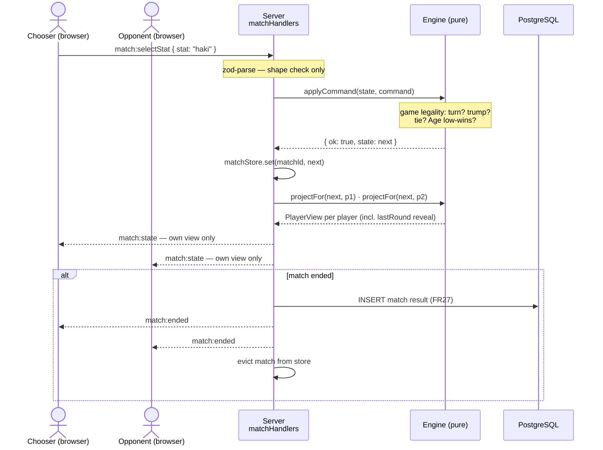

# Architecture Decision Document

_This document builds collaboratively through step-by-step discovery. Sections are appended as we work through each architectural decision together._

## Project Context Analysis

### Requirements Overview

**Functional Requirements:**
31 FRs in 7 groups. Architecturally they decompose into: (1) a deterministic
game rules engine (deck/setup FR6–10, rounds FR11–16, Super Trump FR17–19,
ties FR20–23, match end FR24–26) — pure logic, the project's showcase artifact;
(2) a match/session layer (FR1–5: nickname identity, room creation via
shareable link, auto-start at 2 players, server-authoritative state,
disconnect-forfeit with ~10s detection); (3) a thin persistence layer
(FR27–28: completed-match records + recent-matches view); (4) a minimal
presentation layer (FR29–30: placeholder cards, turn/stack/pot visibility,
holder-only Super Trump marker, chooser call-out reveal).

**Non-Functional Requirements:**
- NFR1 (engine isolated, deterministic, unit-testable) — drives a pure game
  core with injected randomness; no transport/DB/UI imports.
- NFR2 + FR4 (hidden-information integrity) — drives per-player state
  projection at the server boundary; full state never serialized to clients.
- NFR3 (~1s action reflection) — drives a push-capable transport; trivial load
  (2 clients/match) means no scaling architecture needed.
- NFR4 (evergreen desktop browsers, mobile-usable) — standard web client.
- NFR5 (nicknames only, no PII) — keeps auth/data-protection scope near zero.
- NFR6 (runs locally and on one small host) — single-process-friendly
  deployment; no distributed-systems machinery.

**Scale & Complexity:**
- Primary domain: full-stack web (browser client + stateful server + small DB)
- Complexity level: low-to-medium (turn-based real-time + hidden info is the
  only medium-complexity concern)
- Estimated architectural components: ~5 (game engine core, match/session
  manager, transport boundary, persistence adapter, web client)

### Technical Constraints & Dependencies

- TypeScript, unit testing, modern JS patterns (addendum stack intent).
- Database persistence required; engine choice OPEN — relational (Postgres
  +JSONB) vs document (MongoDB) under deliberation, to be decided in the
  data-layer step with pros/cons recorded.
- Deployment: Danilo-operated, local + single small remote host.
- Process constraint (revised 2026-07-16, PRD D23): AI implements via BMAD;
  Danilo requests features and approves. Architecture decisions must still be
  explicit and justified. (Original binding constraint — Danilo hand-writes
  all code, AI guides/reviews only — applied through story 2.5.)
- Counter-metric from PRD: time-to-playable — bias against gold-plating.

### Cross-Cutting Concerns Identified

1. **Hidden-information boundary** — affects engine API, transport payloads,
   and client state shape (per-player projections everywhere).
2. **Deterministic randomness** — shuffle, Super Trump draw (Buggy excluded),
   first chooser; all randomness injected/seedable for tests.
3. **Future-proofing seams (cheap only):** player list not 2-player literals;
   deck as data behind an interface (themes later); session identity stub
   (reconnect later). Extend-not-rewrite is a PRD goal.
4. **Match lifecycle state machine** — waiting → playing → tie-chain →
   ended(reason); end states must reconcile all 32 cards incl. pot (FR25b).
5. **Disconnect detection** — transport-level concern feeding a game-level
   rule (forfeit); keep the two decoupled.

## Starter Template Evaluation

### Primary Technology Domain

Full-stack web: React SPA client + long-lived Node/Express game server +
PostgreSQL — a 3-package TypeScript monorepo (client / server / shared
game engine).

### Starter Options Considered

- create-react-app — deprecated; excluded.
- T3 stack / full-stack boilerplates — pre-decide Next.js, tRPC, ORM, styling;
  wrong runtime shape for a stateful socket server and contrary to the
  learning goal (too many decisions pre-made, too much unowned code).
- NestJS starter — excluded with the Express choice (framework magic reduces
  the "I wrote this" interview value).
- **Selected: minimal-generator approach** — official Vite scaffold for the
  client; server, shared engine package, and monorepo wiring hand-built by
  Danilo following the reference structure in this document.

### Selected Starter: create-vite (client only) + hand-assembled monorepo

**Rationale for Selection:**
Matches the "comfortable middle" setup style: the only generated code is
Vite's ~10-file react-ts scaffold (config + entry point — treated as config
scaffolding, permitted under the working agreement). All architecture-bearing
setup (workspaces, server, engine package, test wiring) is hand-built, because
setup itself is interview material. Bias: time-to-playable without unowned code.

**Initialization Command:**

```bash
# in repo root (hand-written package.json with "workspaces": ["packages/*"])
npm create vite@latest packages/client -- --template react-ts
# server + engine packages: hand-created (npm init -y, tsconfig by hand)
```

**Architectural Decisions Provided by Starter (verified 2026-06-10):**

**Language & Runtime:** TypeScript 6.0.x, Node.js 24 LTS, ES modules throughout.

**Styling Solution:** none imposed — plain CSS to start (placeholder UI per
PRD FR29); revisit only if the UI grows.

**Build Tooling:** Vite 8 (client dev server + build); plain `tsc` for server
and engine packages (no bundler needed server-side).

**Testing Framework:** Vitest 4 across all packages — Vite-native, zero-config
TS/ESM, Jest-compatible API (interview-transferable). Engine package is the
unit-test showcase.

**Code Organization:** npm workspaces monorepo (sane minimal choice at
2–3 packages; pnpm only pays off at scale):

    packages/engine  — pure rules engine: no deps on transport/DB/React
    packages/server  — Express 5 + game session layer; depends on engine
    packages/client  — React 19 (Vite); depends on engine types only

**Development Experience:** Vite HMR on client; tsx watch (or tsc --watch +
node) on server — exact dev-script wiring is Danilo's to build, documented
as a story.

**Note:** Project initialization using this approach is the first
implementation story — typed by Danilo, guided not generated.

**Preferences recorded (step 3):** React 19 · Express 5 · PostgreSQL + JSONB
(lean, formalized in data-layer decision) · "comfortable middle" setup style.

## Core Architectural Decisions

### Decision Priority Analysis

**Critical Decisions (Block Implementation):**
- Real-time transport: Socket.IO 4.8.x
- Database + access: PostgreSQL with JSONB, raw `pg` 8.21 + hand-written SQL
- Active-match state location: in-memory on the server
- Client state: React built-ins (useReducer + context)

**Important Decisions (Shape Architecture):**
- Validation: zod 4 at all boundaries
- Migrations: node-pg-migrate 8 (raw SQL migrations)
- Session identity: unguessable room code + per-player token
- API split: thin REST for lobby/history, Socket.IO events for gameplay

**Deferred Decisions (Post-MVP, consciously):**
- Deployment target (bare local dev now; NFR6's remote host chosen when
  v1 is playable — revisit trigger: first friend match over the internet)
- CI pipeline (GitHub Actions running vitest is the assumed shape; wire it
  when the engine package has tests worth protecting)
- Caching, rate limiting, scaling, CDN: N/A at 2 clients/match — skipped
  deliberately, not forgotten.

### Data Architecture

- **PostgreSQL + JSONB over MongoDB** (decided after explicit pros/cons).
  Rationale: v1 data is one flat `matches` table — both stores trivially
  sufficient; Postgres wins on roadmap fit (relational spine for future
  accounts/history + JSONB for future document-shaped theme configs and
  state snapshots) and on interview surface (SQL, schema design,
  migrations). MongoDB retained as rejected-alternative talking point.
- **Raw `pg` (8.21) + hand-written SQL.** No ORM: schema size doesn't
  justify abstraction, and SQL fluency is the practice target.
  node-pg-migrate (8.0.x) for migrations, written as SQL.
- **Active match state lives in server memory** (a Map of matchId →
  match state). The DB sees only completed matches (FR27). Consequence,
  accepted: server restart kills in-flight matches — acceptable at v1
  stakes, aligned with instant-forfeit semantics; revisit with reconnect.
- **Validation with zod 4 at boundaries:** every client→server payload
  (REST body, socket event) parsed before it touches game logic. Engine
  itself trusts its inputs (server-side only).
- **Deck data:** hardcoded TypeScript module in the engine package,
  typed as data behind a `Deck` interface (theme seam, cheap now).

### Authentication & Security

- **No accounts/auth (PRD).** Identity = match-scoped.
- **Room code:** short unguessable ID in the share link — possession is
  the only credential (acceptable: no PII, NFR5).
- **Player token:** random token issued at join, sent with every socket
  event; prevents trivial impersonation within a match and is the seam
  reconnect will later use.
- **Hidden-information enforcement is structural:** the server sends only
  per-player projections (step-05 pattern); no payload ever contains
  opponent stack contents or Super Trump location.
- Basic hardening only: CORS locked to known origin, JSON body limits.
  Helmet/rate limiting consciously deferred (private links, two users).

### API & Communication Patterns

- **Split:** REST (Express 5.2) for the non-realtime edges — create match,
  join info, recent matches (FR28). Socket.IO 4.8 for everything in-match.
- **One shared http.Server** hosts both Express and Socket.IO (standard
  integration pattern).
- **Typed event protocol:** discriminated-union message types
  (client→server commands, server→client state events) defined in the
  shared engine/types package — single source of truth for both sides,
  and deliberate TS-pattern practice.
- **Disconnect detection configured, not defaulted:** Socket.IO defaults
  (pingInterval 25s + pingTimeout 20s) violate FR5's ~10s window.
  Set pingInterval + pingTimeout so detection lands ≈10s (e.g. 5s + 5s).
- **Error standard:** zod-rejected or rule-illegal commands return a typed
  error event to the sender only; server state never mutates on bad input.

### Frontend Architecture

- **React 19 built-ins only:** one reducer holds connection + game-snapshot
  state; socket events dispatch actions; context provides state to the tree.
  Rationale: client state IS a server projection — a reducer over events
  models it exactly; "no state library, and here's why" is the interview
  answer.
- **No router:** three screens (home/create-join, match, result) driven by
  a screen state machine in the reducer. react-router added only if URLs
  beyond the share link ever matter.
- **No perf machinery:** placeholder UI, two users; Vite defaults suffice.

### Infrastructure & Deployment

- **Bare local install:** Postgres via Homebrew, Node 24 run directly,
  npm scripts as the only orchestration. Zero container overhead; chosen
  for simplicity now.
- **Consequence, accepted:** environment reproducibility and deployment are
  deferred; NFR6 (remote host) is an open obligation with a defined
  revisit trigger (v1 playable locally).
- Config via environment variables with a `.env` file locally (12-factor
  style), so the eventual deploy doesn't force refactoring.

### Decision Impact Analysis

**Implementation Sequence:**
1. Monorepo + engine package skeleton (pure TS, Vitest) — no I/O deps
2. Engine rules + tests (the showcase) against hardcoded deck
3. Server: Express + Socket.IO + in-memory match manager + projections
4. Client: reducer + socket wiring + three screens
5. Postgres: matches table, migration, FR27 write + FR28 read
6. Deployment (deferred decision lands here)

**Cross-Component Dependencies:**
- Typed event protocol (shared package) couples server projections and
  client reducer — define it before either side.
- FR5's 10s window depends on Socket.IO ping config — server setup story
  must carry it explicitly.
- In-memory state + instant forfeit are mutually consistent; introducing
  reconnect later touches both (token seam already in place).
- Engine's deck-behind-interface seam is what keeps multi-theme
  "extend, not rewrite."

## Implementation Patterns & Consistency Rules

_The implementing "agent" here is Danilo (hand-written code, many sessions
apart) plus AI review. These patterns are the consistency contract both
follow; reviews check against this section._

### Naming Patterns

**Database:** snake_case throughout. Tables plural (`matches`); columns
snake_case (`winner_nickname`, `end_reason`, `created_at`); PK `id`;
indexes `idx_<table>_<cols>` (`idx_matches_created_at`).

**REST API:** lowercase plural resources under `/api`:
`POST /api/matches` (create), `GET /api/matches/recent` (FR28).
Route params camelCase (`:matchId`). JSON fields camelCase — the
repository layer maps snake_case columns ↔ camelCase fields; SQL never
leaks past it.

**Socket events:** `domain:action` camelCase, typed via Socket.IO's
`ClientToServerEvents` / `ServerToClientEvents` interface maps in the
engine package. Commands (client→server): `match:join`, `match:selectStat`,
`match:rematch`. Events (server→client): `match:state`, `match:ended`,
`match:error`.

**Code:** React components PascalCase files (`CardView.tsx`); all other
modules camelCase (`matchManager.ts`); types/interfaces PascalCase, no
`I` prefix; functions/variables camelCase; true constants
SCREAMING_SNAKE_CASE. One concept = one name everywhere: it is `match`
(not game/room/session), `stat` (not attribute/category), `stack`,
`pot`, `superTrump`, `chooser` — mirroring PRD vocabulary.

### Structure Patterns

- Tests co-located: `deck.test.ts` beside `deck.ts` (Vitest default,
  keeps the showcase tests next to the showcase code).
- `packages/engine` organized by domain concept (`deck`, `match`,
  `round`, `projection`, `protocol`); no `utils` dumping ground.
- `packages/server` organized by layer (`routes/`, `sockets/`, `store/`
  in-memory matches, `db/` repository + migrations).
- `packages/client` organized by role (`components/`, `state/` reducer +
  context, `socket/` wiring).
- Shared protocol & game types live in the engine package and are
  imported by both server and client — no fourth package.

### Format Patterns

- REST success: direct payload + correct status (200/201). REST/socket
  errors share one shape: `{ error: { code: string, message: string } }`
  with stable machine codes (`MATCH_FULL`, `INVALID_STAT`, …).
- Dates: TIMESTAMPTZ in Postgres, ISO 8601 strings in JSON.
- Bounty values are plain JS numbers (max 5.56e9 — far under
  Number.MAX_SAFE_INTEGER; no BigInt ceremony).
- The match/room identifier is ONE concept: the unguessable `matchId`
  in the share link. No separate room code.

### Communication & State Patterns

- **Full-snapshot protocol:** after every accepted command the server
  sends each player their complete filtered `PlayerView` via
  `match:state`. No deltas, no client-side rule simulation — the client
  renders what it's told. (Sync bugs become structurally impossible;
  payload cost irrelevant at this scale.)
- **Projection is the only door:** `projectFor(state, playerId): PlayerView`
  in the engine is the single place full state becomes player-visible
  state. Server code never hand-builds payloads from raw match state.
- **Client reducer:** immutable updates only; action types mirror socket
  events 1:1 (`match:state` → `MATCH_STATE_RECEIVED`) plus local UI
  actions; one reducer owns connection + screen + snapshot state.
- **Engine API — functional core:** pure transition function
  `applyCommand(state, command): CommandResult` where `CommandResult`
  is a discriminated union: `{ok: true, state, effects}` |
  `{ok: false, error}`. No mutable classes; randomness enters only as
  an injected `Rng` (seedable in tests); engine never throws for rule
  violations — throws are reserved for programmer error.

### Process Patterns

- **Validation timing:** zod-parse every external payload at the boundary
  (route handler / socket handler) BEFORE calling the engine; the engine
  then enforces game legality. Two layers, two jobs: shape vs rules.
- **Error flow:** invalid input → typed error event to sender only;
  state unchanged; nothing logged above debug (it's normal traffic).
  Unexpected exceptions → match aborted safely, error logged with
  matchId context.
- **Loading/connection state:** single client-side status enum
  (`connecting | connected | disconnected`), rendered by one indicator
  component, never duplicated in ad-hoc booleans.
- **Logging:** leveled console logging with matchId prefix on the server;
  no logging library until there's a need.

### Enforcement Guidelines

**All code MUST:**
- Pass through projection before any state leaves the server (NFR2).
- Keep `packages/engine` free of imports from server/client/pg/socket.io.
- Use the shared protocol types — no inline retyping of payloads.

**Enforcement:** AI code review checks each commit against this section;
deviations are either fixed or, if the pattern proved wrong, the pattern
is amended HERE first (document is the source of truth).

### Pattern Examples

Good: `match:selectStat` handler → zod parse → `applyCommand` →
`projectFor` each player → emit `match:state` ×2.
Anti-pattern: socket handler reaching into match state to build a custom
payload (bypasses projection — the one unforgivable sin in this codebase).
Anti-pattern: engine importing `socket.io` types "just for convenience"
(breaks NFR1 isolation).

## Project Structure & Boundaries

### Complete Project Directory Structure

```
card-clash/
├── package.json                  # root: "workspaces": ["packages/*"], dev/test scripts
├── package-lock.json
├── tsconfig.base.json            # shared strict compiler options; packages extend it
├── .env.example                  # DATABASE_URL, PORT, CLIENT_ORIGIN (committed)
├── .env                          # local values (gitignored)
├── .gitignore
├── README.md
└── packages/
    ├── engine/                   # PURE — no socket.io, no pg, no React, no Node APIs
    │   ├── package.json
    │   ├── tsconfig.json
    │   └── src/
    │       ├── index.ts              # public API barrel (only door into the engine)
    │       ├── types.ts              # Card, StatKey, MatchState, PlayerView, EndReason…
    │       ├── rng.ts                # Rng interface + default impl + seedable test impl
    │       ├── deck/
    │       │   ├── deck.ts           # Deck interface (theme seam)
    │       │   ├── onePieceDeck.ts   # FR6: the hardcoded 32 cards (PRD Appendix A)
    │       │   └── deck.test.ts      # 32 cards, 8 stats, Buggy flag, age low-wins flag
    │       ├── match/
    │       │   ├── setup.ts          # FR7–10: shuffle, deal, Super Trump draw, first chooser
    │       │   ├── applyCommand.ts   # THE transition fn: (state, command) → CommandResult
    │       │   ├── round.ts          # FR11–16: comparison incl. Age low-wins, FR17–19 trump
    │       │   ├── ties.ts           # FR20–23: pot mechanics, tie chains, tie elimination
    │       │   ├── end.ts            # FR24–26 + FR25b: end states, pot disposition, cap
    │       │   └── *.test.ts         # co-located per module — the interview showcase
    │       ├── projection/
    │       │   ├── projectFor.ts     # (state, playerId) → PlayerView — the NFR2 door
    │       │   └── projectFor.test.ts# MUST assert hidden info absent, trump marker rules
    │       └── protocol/
    │           ├── events.ts         # ClientToServerEvents / ServerToClientEvents maps
    │           └── commands.ts       # zod schemas for every client command payload
    ├── server/                   # imports engine; owns all I/O
    │   ├── package.json
    │   ├── tsconfig.json
    │   └── src/
    │       ├── index.ts              # entry: one http.Server ← Express 5 + Socket.IO
    │       │                         #   (pingInterval/pingTimeout set for FR5 ≈10s)
    │       ├── config.ts             # env parsing (zod-validated, fail-fast)
    │       ├── routes/
    │       │   └── matches.ts        # POST /api/matches · GET /api/matches/recent
    │       ├── sockets/
    │       │   └── matchHandlers.ts  # match:join / match:selectStat / match:rematch
    │       │                         #   + disconnect → forfeit; zod-parse → applyCommand
    │       │                         #   → projectFor ×2 → emit match:state
    │       ├── store/
    │       │   └── matchStore.ts     # in-memory Map<matchId, {state, tokens, sockets}>
    │       └── db/
    │           ├── pool.ts           # pg Pool (the only file that imports pg)
    │           ├── matchRepository.ts# FR27 insert · FR28 recent query (hand-written SQL)
    │           └── migrations/       # node-pg-migrate files (SQL)
    └── client/                   # imports engine TYPES only (import type — zero runtime)
        ├── package.json
        ├── tsconfig.json
        ├── vite.config.ts
        ├── index.html
        └── src/
            ├── main.tsx
            ├── App.tsx               # screen switch: home | match | result
            ├── styles.css            # plain CSS, placeholder aesthetics
            ├── socket/
            │   └── socket.ts         # typed Socket.IO client; events → dispatch
            ├── state/
            │   ├── reducer.ts        # one reducer: connection + screen + PlayerView
            │   └── context.tsx       # provider + hooks (useGameState/useDispatch)
            └── components/
                ├── HomeScreen.tsx    # nickname, create/join via link (FR1–3)
                ├── MatchScreen.tsx   # FR30: card, counts, pot, turn, call-out reveal
                ├── ResultScreen.tsx  # FR26: winner, reason, rounds, rematch
                └── CardView.tsx      # FR29: name + 8 stat rows + trump marker (FR19)
```

### Architectural Boundaries

- **Engine boundary (hard):** `packages/engine` imports only zod. Anything
  needing a socket, the DB, React, or Node APIs is by definition not engine
  code. Enforced by review + package.json deps.
- **API boundary:** REST = match creation & history (stateless edges);
  Socket.IO = everything during play. No gameplay over REST, ever.
- **Hidden-info boundary:** `projectFor` is the only path from MatchState
  to anything serializable to a client. `match:state` payloads carry
  `PlayerView`, never `MatchState`.
- **Data boundary:** SQL exists only inside `matchRepository.ts`; the
  store (RAM, live matches) and the repository (Postgres, finished
  matches) never cross.

### Requirements to Structure Mapping

- FR1–5 (sessions/disconnect) → server `routes/matches.ts`,
  `sockets/matchHandlers.ts`, `store/matchStore.ts`; index.ts ping config
- FR6–26 (all game rules) → engine `deck/`, `match/`, with FR19/NFR2 in
  `projection/`
- FR27–28 (persistence) → server `db/`
- FR29–30 (UI) → client `components/`
- NFR1 → engine package isolation + co-located Vitest suites
- NFR2 → `projection/` + the hidden-info boundary above
- NFR3 → Socket.IO push (`match:state` after every accepted command)

### Data Flow (one round, end to end)

Chooser clicks stat → `match:selectStat` → server zod-parses →
`applyCommand(state, cmd)` → ok: store updated → `projectFor` per player
→ `match:state` ×2 → client reducers update → both screens re-render.
On match end: additionally `matchRepository.insert(...)` (FR27) and
`match:ended` event.

### Development Workflow Integration

- Root scripts: `npm run dev` (concurrently: tsx watch server + vite
  client), `npm test` (vitest across workspaces), `npm run build`
  (engine → server → client order).
- Dev runtime uses tsx (no build step); production build is plain tsc
  for engine/server, vite build for client.
- Engine consumed via workspace symlink + TS project references kept
  OUT for now (build-order via script is enough at 3 packages —
  revisit if builds get slow).

## Architecture Validation Results

### Coherence Validation ✅

**Decision Compatibility:** TS 6 / Node 24 / React 19 / Express 5 /
Socket.IO 4.8 / Vitest 4 / pg 8.21 / zod 4 — all current-stable,
no known incompatibilities (versions verified 2026-06-10). Engine's
sole dependency (zod) is runtime-agnostic, preserving NFR1 isolation.

**Pattern Consistency:** Functional-core engine ↔ full-snapshot protocol
↔ single client reducer form one coherent loop (command in → snapshot
out → render). Naming patterns use PRD vocabulary end to end.

**Structure Alignment:** The 3-package tree physically enforces the two
hardest rules: engine purity (package boundary) and hidden-info
integrity (projection module is the only serialization path).

### Requirements Coverage Validation ✅

**Functional:** FR1–5 → server sessions/store/ping-config; FR6–26 →
engine deck/match/projection; FR27–28 → server db/; FR29–30 → client
components. Every FR has a named home (see step-6 mapping). 31/31.

**Non-Functional:** NFR1 package isolation + injected Rng; NFR2
projection boundary + mandated projectFor tests; NFR3 Socket.IO push;
NFR4 standard SPA (mobile = plain responsive CSS, no extra machinery);
NFR5 nickname-only data model; NFR6 single-process design. 6/6.

### Implementation Readiness Validation ✅

Decisions carry versions and rationale; patterns cover naming, structure,
formats, communication, and process with examples and anti-patterns;
the tree is file-level specific with FR mapping. The implementing
developer (Danilo) + AI reviewer have an unambiguous contract.

### Gap Analysis Results

No critical gaps. Three important-but-small gaps found and resolved
below. Nice-to-have (deferred, consistent with counter-metric):
CI wiring, deployment target, server integration tests beyond engine
unit suites, tsx pinning (dev-tool choice at implementation time).

### Validation Issues Addressed

1. **In-memory match eviction (leak prevention):** matches are removed
   from matchStore after `match:ended` is emitted and the FR27 row is
   written. Rematch = new matchId in a fresh store entry.
2. **`PlayerView.lastRound`:** the snapshot includes the most recent
   round's revealed outcome (both played cards, chosen stat, values,
   winner, pot delta) — this is what makes FR12's call-out renderable
   under the full-snapshot protocol. Revealed-once information is no
   longer hidden information.
3. **FR28 placement:** recent-matches list renders in `HomeScreen`
   (fetch on mount of `GET /api/matches/recent`).

### Architecture Completeness Checklist

**Requirements Analysis**
- [x] Project context thoroughly analyzed
- [x] Scale and complexity assessed
- [x] Technical constraints identified
- [x] Cross-cutting concerns mapped

**Architectural Decisions**
- [x] Critical decisions documented with versions
- [x] Technology stack fully specified
- [x] Integration patterns defined
- [x] Performance considerations addressed

**Implementation Patterns**
- [x] Naming conventions established
- [x] Structure patterns defined
- [x] Communication patterns specified
- [x] Process patterns documented

**Project Structure**
- [x] Complete directory structure defined
- [x] Component boundaries established
- [x] Integration points mapped
- [x] Requirements to structure mapping complete

### Architecture Readiness Assessment

**Overall Status:** READY FOR IMPLEMENTATION
**Confidence Level:** High — small surface, decisions mutually
reinforcing, every FR mapped; residual risk is engine edge-case
subtlety (tie chains, pot disposition), mitigated by the unit-test-first
sequence.

**Key Strengths:** engine purity as a package boundary (not a promise);
projection as the single hidden-info door; full-snapshot protocol
eliminating sync bugs; every decision carries an interview-ready
rationale with rejected alternatives.

**Areas for Future Enhancement:** deployment + CI (defined revisit
triggers); grace-period reconnect (token seam in place); multi-theme
(deck interface seam in place); >2 players (player-list shape in place).

### Implementation Handoff

**Guidelines (revised 2026-07-16, PRD D23):** AI implements against this
document; Danilo approves stories. Decisions are followed as documented;
if reality disproves one, amend this document first, then the code.

**First Implementation Priority:** hand-write root package.json
(workspaces) + tsconfig.base.json + engine package skeleton with one
passing Vitest test — then `npm create vite@latest packages/client -- --template react-ts`.

## Architecture Diagrams

_Added 2026-06-10 (Paige, tech-writer). Two complementary views: structure
(boundaries) and behavior (one round end to end)._

### Component & Boundary View



### One Round, End to End



_Reading notes: the 🔒 on `projectFor` is NFR2 made visible — every byte a
client receives passes through that box. The dotted client→protocol arrow
means types flow at compile time but no engine runtime code ships to the
browser._
